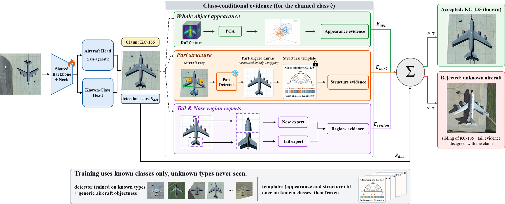
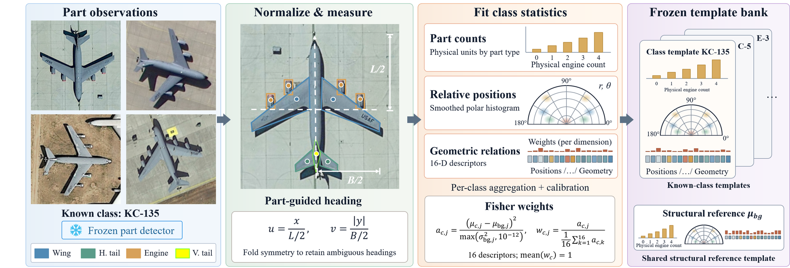
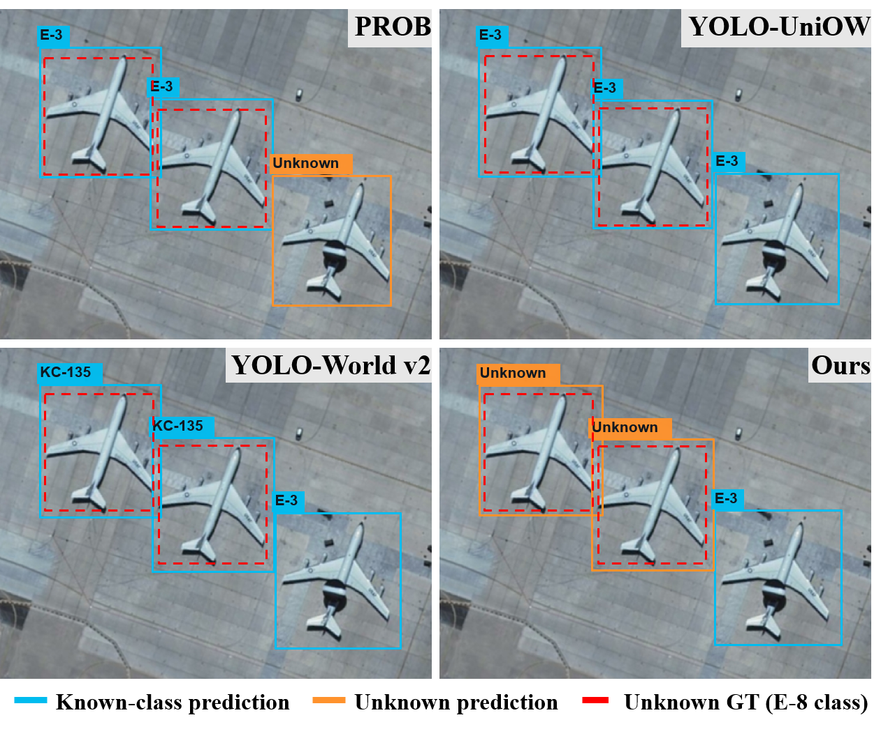

# VERA: When Unknown Aircraft Look Familiar

**Open-World Aircraft Detection with Coarse-to-Fine Structural Evidence in Satellite Imagery**

*Code and data for an anonymous submission. Author information is withheld for double-blind review.*

---

Open-world aircraft detectors are built to *find* unseen aircraft. A harder failure starts after the
aircraft is found: an unseen type that **resembles** a known type is reported under the familiar
identity, although that identity may carry a different operational role. We call this failure
**familiarity**.

**VERA** (Verified Evidence Recognition of Aircraft) separates discovery from identity. Each detected
aircraft carries a *claimed* class, and the claim is verified against a background reference of
aircraft in general, using evidence at three granularities:

1. whole-object **appearance**,
2. **part structure** (part counts, positions and geometry),
3. **tail and nose region experts**.

Local disagreement can therefore overturn a plausible global appearance. With every method's
threshold calibrated on the development split and frozen on the test split, VERA rejects **46.6%** of
look-alike unknowns on MAR20 (strongest open-world detector: 36.9%; best post-hoc score: 33.0%) while
keeping the highest known AP50 (**93.3**).

<p align="center"></p>

## Method

A shared YOLO-World trunk feeds a class-agnostic aircraft head and a known-class head. The claim is
c = argmax<sub>k</sub> q<sub>k</sub>(x). It is verified by adding five evidence terms, each divided by
its standard deviation over localized known proposals of the development split:

```
V(x, c) = log(a(x)·q_c(x))/σ_det + ℓ_app(x, c)/σ_app + ℓ_str(x, c)/σ_str + m_tail(x, c)/σ_tail + m_nose(x, c)/σ_nose
          └──────────────── coarse ────────────────┘   └───────────────────── fine ─────────────────────┘
```

The claim is accepted when V ≥ τ. Otherwise the box keeps its location and is relabelled
**unknown**. τ retains 90.5% of localized known aircraft **on the development split** and is then
frozen. The scales σ are fitted on the development split as well; nothing is fitted on unknowns or on
the test split.

| Evidence | Idea | Code |
|---|---|---|
| Appearance ℓ<sub>app</sub> | PCA-whitened RoI feature; Gaussian LLR of the claimed class **vs. a background of aircraft in general** (Ledoit–Wolf shrinkage) | [`vera/appearance.py`](vera/appearance.py) |
| Structure ℓ<sub>str</sub> | Parts from a DINO part detector; size-normalized polar coordinates; count, polar and Fisher-weighted geometry scores; class−background contrast | [`vera/structure.py`](vera/structure.py) |
| Region experts m<sub>tail</sub>, m<sub>nose</sub> | Part-aligned 224×224 tail and nose canvases; ConvNeXt-Tiny experts; claimed-class margin clipped to [−3, 3] | [`vera/experts.py`](vera/experts.py) |
| Alignment | Heading axis, origin and half-wingspan from detected parts | [`vera/geometry.py`](vera/geometry.py) |
| Decision | Development-split scales, standardized sum, frozen threshold, accept / unknown | [`vera/fusion.py`](vera/fusion.py) |
| Evaluation | Achieved retention, known E2E, unknown rejection, scene-family bootstrap with τ fixed | [`vera/evaluation.py`](vera/evaluation.py) |

<p align="center"></p>

## Protocol

- **MAR20 splits** ([`data/splits.json`](data/splits.json)): train 1,805 / development 663 / test 1,374 images, split by airfield scene family.
- **Unknown types:** E-8, Tu-22 and KC-10 form the **look-alike** group (LA); F-22 and Tu-95 are distinct. The five fighter types are neither known nor evaluated.
- **Thresholds:** every method, VERA and all baselines, uses the threshold that retains 90.5% of localized known aircraft on the development split, frozen on test. The development and test splits differ in class mix, so achieved test retention (Ret.) differs from 90.5%. It is reported for every method.
- **E2E:** fraction of all known ground-truth aircraft that are localized, accepted and correctly labelled.
- **Intervals:** 95% scene-family bootstrap on the test split with each method's τ held fixed.

## Results

### Task 1 (MAR20 test split, development-calibrated frozen thresholds)

| Method | Ret. | U-Recall ↑ | U-Precision ↑ | WI ↓ | A-OSE ↓ | All-5 ↑ | LA ↑ | AP50 ↑ | E2E ↑ |
|---|---:|---:|---:|---:|---:|---:|---:|---:|---:|
| Conf. (obj×cls) | 95.2 | 53.3 | 57.1 | 0.1546 | 991 | 53.2 | 32.4 | 86.7 | 92.7 |
| MSP | 95.2 | 52.7 | 57.2 | 0.1470 | 1004 | 52.6 | 31.9 | 86.5 | 92.8 |
| MaxLogit | 95.2 | 52.7 | 57.2 | 0.1470 | 1004 | 52.6 | 31.9 | 86.5 | 92.8 |
| Energy | 95.0 | 52.8 | 57.0 | 0.1474 | 1002 | 52.7 | 33.0 | 86.4 | 92.6 |
| GEN | 94.8 | 58.0 | 61.3 | 0.1223 | 887 | 58.0 | 28.7 | 87.8 | 92.9 |
| MDS | 96.4 | 21.1 | 45.8 | 0.3388 | 1691 | 21.0 | 5.3 | 80.5 | 93.1 |
| RMDS | 97.6 | 33.0 | 53.3 | 0.1474 | 1430 | 32.8 | 19.8 | 88.1 | **94.7** |
| ResNet-50 crop verifier | 94.2 | 78.8 | **66.9** | 0.1152 | **446** | **78.6** | **52.0** | 82.1 | 93.9 |
| ResNet-50 + conf. | 94.8 | 74.0 | 64.5 | 0.0910 | 547 | 73.9 | 37.6 | 89.8 | 94.4 |
| PROB | 90.7 | 31.4 | 0.7 | 0.2275 | 5431 | 19.5 | 18.7 | 78.0 | 82.7 |
| OWOBJ | 94.5 | **95.7** | 1.6 | 0.2338 | 1058 | 46.3 | 28.7 | 81.2 | 92.5 |
| OW-DETR | 93.6 | 69.7 | 2.7 | 0.2453 | 1477 | 37.1 | 19.7 | 80.7 | 87.7 |
| OrthogonalDet | 94.0 | 50.2 | 30.8 | 0.1483 | 1014 | 50.1 | 36.9 | 85.0 | 91.9 |
| CROWD | 94.9 | 64.8 | 9.3 | 0.1374 | 1113 | 44.3 | 28.6 | 86.3 | 92.6 |
| YOLO-UniOW | 96.2 | 37.3 | 37.5 | 0.2395 | 1227 | 39.8 | 13.8 | 81.6 | 91.8 |
| YOLO-World v2-S | 95.2 | 71.7 | 6.2 | 0.1587 | 1006 | 53.1 | 25.9 | 85.7 | 93.3 |
| **VERA** | 94.7 | 77.4 | 65.8 | **0.0291** | 475 | 77.2 | 46.6 | **93.3** | 94.3 |

Post-hoc scores and the ResNet-50 verifier re-score the proposals of VERA's own detector. VERA's
look-alike rejection minus OrthogonalDet's: 95% interval [1.8, 18.8]; minus MSP's: [8.3, 23.3].

The ResNet-50 crop verifier (ImageNet ResNet-50 trained on known-type training crops, scoring the
claimed-class margin) is a strong rejector, but its advantage depends on the operating point:

| Operating point | Ret. | LA ResNet-50 | LA VERA | VERA − ResNet-50 (95% CI) | AP50 ResNet-50 | AP50 VERA | KC-10 ResNet-50 | KC-10 VERA |
|---|---:|---:|---:|---:|---:|---:|---:|---:|
| Development-frozen τ | 94.2 / 94.7 | 52.0 | 46.6 | [−10.5, 0.3] | 82.1 | 93.3 | 40.7 | 59.9 |
| Matched 90.5% test retention | 90.5 | 59.8 | 63.8 | [−4.9, 13.6] | 79.0 | 89.8 | 45.2 | 80.2 |

Neither leads significantly in look-alike rejection at either point. The verifier rejects more Tu-22,
and VERA rejects more KC-10 and F-22 (significant at matched retention). The verifier's known AP50
and WI (0.115 vs 0.029) are much worse, because the crop margin does not rank duplicate and poorly
localized boxes below well-localized ones. The two kinds of evidence are complementary.

### Per-type unknown rejection (%)

| Method | E-8 ↑ | Tu-22 ↑ | F-22 ↑ | Tu-95 ↑ | KC-10 ↑ |
|---|---:|---:|---:|---:|---:|
| Conf. (obj×cls) | 10.5 | 48.4 | 99.2 | 53.6 | 24.3 |
| Energy | 10.9 | 49.5 | 99.2 | 51.9 | 23.7 |
| GEN | 15.4 | 35.8 | 98.4 | 68.8 | 29.9 |
| ResNet-50 crop verifier | **55.9** | **54.4** | 91.0 | **98.5** | 40.7 |
| OrthogonalDet | 32.4 | 48.4 | 95.8 | 43.5 | 15.3 |
| CROWD | 28.7 | 36.5 | 95.0 | 38.2 | 9.0 |
| YOLO-UniOW | 17.0 | 13.3 | 97.6 | 40.2 | 10.7 |
| YOLO-World v2-S | 14.2 | 36.0 | **100.0** | 59.3 | 17.5 |
| **VERA** | 44.1 | 42.6 | 99.2 | 96.8 | **59.9** |

Identity-level confusion (development-calibrated thresholds, confidence → VERA): Tu-95 accepted as
E-3 175 → 1, Tu-95 as KC-135 173 → 2, E-8 as KC-135 182 → 103, KC-10 as KC-135 122 → 69.

Tu-22 is the one look-alike type for which VERA rejects less than confidence. Most Tu-22 are claimed
as Su-24 and score well below correct Su-24 claims, but the single pooled threshold is set by the
lowest-scoring known classes.

### Unknown rejection across retention levels

Development targets of 70–97%, each threshold frozen on test, plotted against achieved test retention:

<p align="center"></p>

### Cumulative evidence (matched 90.5% test retention)

| Evidence | A-OSE ↓ | AP50 ↑ | All-5 ↑ | LA ↑ |
|---|---:|---:|---:|---:|
| Conf. | 712 | 82.98 | 66.20 | 44.73 |
| + Appearance | 613 | 84.96 | 70.82 | 46.72 |
| + Structure | 478 | 86.85 | 77.11 | 51.76 |
| + Tail | 398 | 89.34 | 80.84 | 57.14 |
| **+ Nose (= VERA)** | **314** | **89.79** | **84.76** | **63.82** |

### Design variants (matched 90.5% test retention)

| Variant | A-OSE ↓ | AP50 ↑ | All-5 ↑ | LA ↑ |
|---|---:|---:|---:|---:|
| **VERA** | 314 | 89.79 | 84.76 | 63.82 |
| Unit weights (no standardization) | 356 | 89.02 | 82.80 | 59.84 |
| Expert Gaussian LLR | 395 | 88.76 | 80.98 | 54.45 |
| No objectness | 313 | 89.76 | 84.80 | 63.93 |
| Uniform structure | 332 | 89.84 | 83.92 | 61.83 |
| No engine-unit count | 322 | 89.87 | 84.38 | 62.88 |
| Appearance vs. knowns (no background reference) | 367 | 90.30 | 82.28 | 57.61 |
| Whole-body expert instead of tail/nose | 501 | 87.37 | 76.04 | 44.85 |

The whole-body expert has the same architecture as the region experts. Its lower rejection shows that
the gain comes from looking at the discriminative regions, not from adding another classifier.

### Robustness

| Check | Look-alike rejection, frozen τ | At matched 90.5% retention |
|---|---:|---:|
| Reported configuration | 46.6 (Ret. 94.7) | 63.8 |
| Part detector retrained on the ten known types only (all stages) | 49.9 (Ret. 94.8) | 70.4 |
| Five training variants (part-detector seeds, expert seed pairs) | 46.1–50.0 | 61.6–66.4 |

MAR20-Parts contains no evaluated unknown type and no test image. Removing the fighter-type part
annotations as well does not lower rejection.

### Task 2: VERA as a complete system after incremental learning

Task 2 learns Tu-22, F-22 and Tu-95 while E-8 and KC-10 stay unknown. The detector, references and
region experts are retrained or refitted at 13 classes, and the scales and threshold come from the
Task-2 development split. At 93.4% test retention:

| | New-class acceptance ↑ | Old-known acceptance ↑ | E-8 + KC-10 rejection ↑ |
|---|---:|---:|---:|
| Confidence | 85.2 | – | 10.4 |
| MSP | 85.4 | – | 11.8 |
| **VERA** | **91.4** | 92.1 | **30.0** |

VERA − confidence: [4.1, 9.1] points in new-class acceptance, [12.0, 28.3] in rejection.

Detector-level incremental AP50 for the open-world baselines (two NMS output rules) is given in the
supplementary material.

### Cross-dataset: RarePlanes (fine-tuned on attribute-defined classes)

| Method | E2E | All | LA | Distinct | Val-frozen Ret. | Val-frozen All | Val-frozen LA |
|---|---:|---:|---:|---:|---:|---:|---:|
| Conf. | 88.3 | 46.5 | 47.6 | 44.7 | 77.9 | 59.9 | 63.3 |
| MSP | **88.7** | 47.5 | 49.7 | 43.7 | 78.6 | 63.5 | 67.4 |
| Energy | 88.6 | 47.9 | 50.3 | 43.7 | 78.7 | 63.5 | 67.4 |
| VERA w/o regions | 87.9 | 53.2 | 56.3 | **47.9** | – | – | – |
| VERA w/o structure | 88.6 | **57.3** | **62.8** | **47.9** | – | – | – |
| **VERA** | 88.2 | 56.4 | 61.4 | **47.9** | 78.9 | **65.2** | **72.8** |

The detector, evidence references and region experts are retrained on attribute-defined known classes
of the RarePlanes training split; the MAR20-Parts part detector stays frozen and has never seen
RarePlanes imagery. On RarePlanes the gain comes from the appearance and region evidence; the part
structure term adds nothing there.

### Latency

**Deployment build: 23.0 images/s (43.3 ms per image) at batch size 1** on an RTX 4060 Laptop GPU, over
all 1,374 test images (22.8–23.1 images/s across four passes).

- Detector, a sparse distilled part encoder and the region experts run as FP16 TensorRT engines.
- Certificates fitted on the development split bound the evidence still to come from the terms already
  computed. Part, region and flipped-view evidence is computed only for claims whose decision they leave
  open: 39.9% of claims are settled after the coarse terms, 22.6% after structure, and flipped expert
  views are needed for 4.9% of region canvases.
- Accuracy relative to the full computation: look-alike rejection −0.23, all-five −0.09, known E2E
  +0.16 points. Per type: E-8 0.0, Tu-22 −1.6, F-22 0.0, Tu-95 0.0, KC-10 +2.8 (5 of 177 aircraft).

| Component (deployment build) | ms |
|---|---:|
| Detector | 8.7 |
| Coarse terms and first certificate | 0.6 |
| Part crops / sparse part detection / decoding | 1.9 / 18.0 / 2.4 |
| Structure and second certificate / region canvases | 3.4 / 1.7 |
| Region experts (flipped views only where needed) | 6.2 |
| **Total** | **43.3** |

The full FP32 reference implementation, which evaluates every term for every proposal, takes 347 ms
per image (P95 648 ms, 192 test images). Part detection takes 180 ms of this time, and structure
scoring plus region experts take 117 ms.

<p align="center"></p>

*Cyan boxes: known classes. Orange boxes: unknown. Dashed red: unknown-aircraft ground truth.*

## Reproducing the main operating points

[`results/scores/`](results/scores/) holds VERA's five evidence terms for every proposal on the
development (3,693) and test (7,397) splits, together with the matching of every MAR20 ground-truth
aircraft to its proposal:

- `*_proposals.csv`: `proposal_index`, `mar20_image_id`, box `x1 y1 x2 y2`, `claimed_class`,
  `log_detection`, `appearance`, `structure`, `tail`, `nose` (clipped), `vera_z`.
- `*_gt_objects.csv`: `mar20_image_id`, `aircraft_type_code`, `label` (0–9 known, 10 unknown,
  −1 fighter, ignored), `matched_proposal_index` (−1 = not localized), `scene_family_id`.

```bash
python scripts/reproduce_frozen_threshold.py --bootstrap 2000
```

```
development scales {'log_detection': 0.7255, 'appearance': 9.3303, 'structure': 2.8002, 'tail': 1.6304, 'nose': 1.1726}
development (calibration)      retention  90.5  look-alike rejection  53.5  all-unknown rejection  76.6  known E2E  90.0
test, dev-frozen tau  [main]   retention  94.7  look-alike rejection  46.6  all-unknown rejection  77.2  known E2E  94.3
test, test-calibrated tau      retention  90.5  look-alike rejection  63.8  all-unknown rejection  84.8  known E2E  90.3
```

Development scores are cross-fitted (5 folds), so the threshold is calibrated on out-of-sample scores,
as on test.

## Usage

```python
import numpy as np
from vera import appearance, structure, experts, fusion

# Coarse evidence: fit once on known + generic training aircraft, then score proposals.
app_model = appearance.fit_appearance(train_features, train_codes)
ell_app = appearance.appearance_llr(app_model, features)                  # (n, 10)

# Part structure from the part detector's outputs.
records = [structure.make_record(row) for row in part_rows]
_, _, ell_str = structure.fit_and_score(training_rows, [{'_record': r} for r in records])

# Region experts: averaged seed logits on the tail / nose canvases.
m_tail = experts.region_evidence(tail_logits, claims, tail_available)
m_nose = experts.region_evidence(nose_logits, claims, nose_available)

rows = np.arange(len(claims))
terms = (np.log(obj * cls[rows, claims]), ell_app[rows, claims], ell_str[rows, claims], m_tail, m_nose)

# Development split: fit scales on localized known proposals, then the threshold.
scales = fusion.fit_scales(*[t[dev_known] for t in dev_terms])
tau = fusion.threshold(fusion.verification_score(*dev_terms, scales=scales)[dev_known])

# Test split: frozen scales and threshold.
V = fusion.verification_score(*terms, scales=scales)
labels = fusion.decide(V, claims, tau)                                    # -1 = unknown
```

Requirements: Python ≥ 3.10, NumPy, SciPy, scikit-learn, OpenCV and PyTorch/torchvision (for the
region experts). See [`requirements.txt`](requirements.txt). Model weights are not included.

## Data

- [`data/splits.json`](data/splits.json): MAR20 train / development / test image ids and scene families.
- [`data/mar20_parts/`](data/mar20_parts/): the MAR20-Parts part annotations (511 aircraft, 4,305
  polygons) in MAR20 image coordinates. See [`data/README.md`](data/README.md).

MAR20 images are available from the official MAR20 release.
