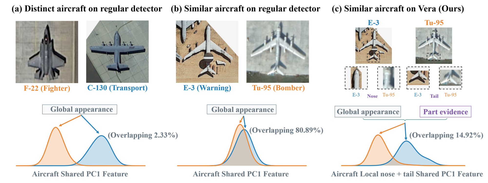
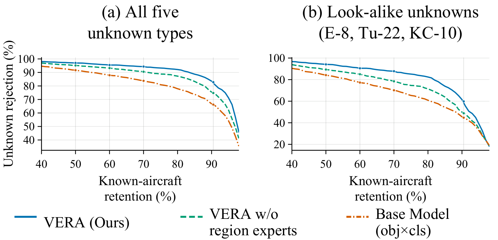

# VERA: When Unknown Aircraft Look Familiar

**Open-World Aircraft Detection with Coarse-to-Fine Structural Evidence in Satellite Imagery**

Yit Hong Wong, Chenglu Lu, Qijun Xia, Hongtian Chen
School of Automation and Intelligent Sensing, Shanghai Jiao Tong University

---

Open-world aircraft detectors are built to *find* unseen aircraft. A harder failure starts after the
aircraft is found: an unseen type that **resembles** a known type gets reported under the familiar
identity, even though that identity may carry a different operational role. We call this failure
**familiarity**.

**VERA** (Verified Evidence Recognition of Aircraft) separates discovery from identity. Each detected
aircraft carries a *claimed* class, and the claim is verified against a background reference of
aircraft in general, using evidence at three granularities:

1. whole-object **appearance**,
2. **part structure** (part counts, positions and geometry),
3. **tail and nose region experts**.

Local disagreement can therefore overturn a plausible global appearance. At 90.5% known-aircraft
retention on MAR20, look-alike rejection rises from **44.7% → 59.8%**, while known AP50 rises from
**83.0 → 89.0**.

<p align="center"></p>

*Global appearance separates distinct aircraft (a) but not look-alikes such as E-3 vs Tu-95 (b).
Local nose and tail evidence restores the separation (c).*

## Method

<p align="center"></p>

A shared YOLO-World trunk feeds a class-agnostic aircraft head and a known-class head. The claim is
c = argmax<sub>k</sub> q<sub>k</sub>(x), and it is verified by summing unit-weight evidence:

```
V(x, c) = log(a(x)·q_c(x)) + ℓ_app(x, c) + ℓ_str(x, c) + m_tail(x, c) + m_nose(x, c)
          └──────── coarse ─────────────┘   └─────────────── fine ───────────────┘
```

The claim is accepted when V ≥ τ<sub>ρ</sub>, where τ<sub>ρ</sub> is the (1−ρ)-quantile of known
scores (ρ = 0.905). Otherwise the box is kept and relabelled **unknown**.

| Evidence | Idea | Code |
|---|---|---|
| Appearance ℓ<sub>app</sub> | PCA-whitened RoI feature; Gaussian LLR of the claimed class **vs. a background of aircraft in general** (Ledoit–Wolf shrinkage) | [`vera/appearance.py`](vera/appearance.py) |
| Structure ℓ<sub>str</sub> | Parts from a frozen DINO part detector; size-normalized polar coordinates; count, polar and Fisher-weighted F-tail geometry scores; leave-one-out standardized class−background contrast | [`vera/structure.py`](vera/structure.py) |
| Region experts m<sub>tail</sub>, m<sub>nose</sub> | Part-aligned 224×224 tail and nose canvases; ConvNeXt-Tiny experts; claimed-class log-odds clipped to [−3, 3] | [`vera/experts.py`](vera/experts.py) |
| Alignment | Heading axis, origin and half-wingspan from detected parts | [`vera/geometry.py`](vera/geometry.py) |
| Decision | Evidence sum, retention-matched threshold, accept / unknown | [`vera/fusion.py`](vera/fusion.py) |
| Evaluation | Known E2E accuracy and unknown rejection at fixed retention | [`vera/evaluation.py`](vera/evaluation.py) |

<p align="center"></p>

Because each regional term is clipped to |m<sub>r</sub>| ≤ 3, the region experts can only decide
claims inside the band |V<sub>0</sub> − τ| < 6, where V<sub>0</sub> is the score without them. In
that band, appearance and structure are inconclusive.

## Results

All results are on the MAR20 test split at **90.5% localized-known retention**.
- **Unknown types:** E-8, Tu-22 and KC-10 form the **look-alike** group (LA); F-22 and Tu-95 are distinct.
- **E2E:** fraction of known ground-truth aircraft that are localized, accepted and correctly labelled.

### Task 1: comparison with open-world detectors and post-hoc scores

| Method | U-Recall ↑ | U-Precision ↑ | WI ↓ | A-OSE ↓ | All-5 ↑ | LA ↑ | AP50 ↑ | E2E ↑ |
|---|---:|---:|---:|---:|---:|---:|---:|---:|
| Conf. (obj×cls) | 66.2 | 58.3 | 0.1526 | 712 | 66.2 | 44.7 | 83.0 | 88.7 |
| MSP | 67.5 | 58.8 | 0.1457 | 685 | 67.5 | 46.6 | 82.9 | 88.7 |
| MaxLogit | 67.5 | 58.8 | 0.1457 | 685 | 67.5 | 46.6 | 82.9 | 88.7 |
| Energy | 67.3 | 58.8 | 0.1460 | 688 | 67.3 | 46.6 | 82.9 | 88.7 |
| GEN | 68.1 | 60.0 | 0.1201 | 672 | 68.1 | 39.7 | 84.7 | 89.4 |
| MDS | 32.9 | 43.8 | 0.3233 | 1435 | 32.6 | 21.2 | 76.9 | 87.3 |
| RMDS | 61.9 | 57.7 | 0.1354 | 807 | 61.8 | 40.6 | 82.9 | 88.6 |
| PROB | 31.7 | 0.7 | 0.2275 | 5421 | 19.9 | 18.7 | 78.0 | 82.5 |
| OWOBJ | **95.7** | 1.6 | 0.2229 | 873 | 55.0 | 35.9 | 78.3 | 88.8 |
| OW-DETR | 72.5 | 2.8 | 0.2338 | 1144 | 46.9 | 26.9 | 78.4 | 85.4 |
| OrthogonalDet | 59.0 | 33.2 | 0.1481 | 824 | 58.9 | 43.7 | 82.7 | 89.0 |
| CROWD | 74.0 | 10.3 | 0.1370 | 755 | 60.9 | 45.8 | 83.2 | 89.0 |
| YOLO-UniOW | 44.3 | 34.6 | 0.2135 | 837 | 57.5 | 29.7 | 78.5 | 87.6 |
| YOLO-World v2-S | 72.6 | 6.2 | 0.1535 | 691 | 67.8 | 40.4 | 82.1 | 89.4 |
| **VERA (ours)** | 82.9 | **64.7** | **0.0561** | **356** | **82.8** | **59.8** | **89.0** | **90.0** |

### Per-type unknown rejection (%)

| Method | E-8 ↑ | Tu-22 ↑ | KC-10 ↑ | F-22 ↑ | Tu-95 ↑ |
|---|---:|---:|---:|---:|---:|
| Conf. (obj×cls) | 21.9 | 61.4 | 36.2 | 99.2 | 72.6 |
| Energy | 25.9 | **63.0** | 35.6 | 99.2 | 73.5 |
| GEN | 26.7 | 46.7 | 40.7 | 99.2 | 81.7 |
| OrthogonalDet | 40.5 | 56.0 | 18.1 | 96.0 | 57.9 |
| CROWD | 54.3 | 52.3 | 18.1 | 95.5 | 60.7 |
| YOLO-UniOW | 36.8 | 24.2 | 33.3 | 97.9 | 66.8 |
| YOLO-World v2-S | 27.5 | 47.9 | 40.1 | **100.0** | 80.1 |
| **VERA (ours)** | **62.8** | 52.8 | **72.9** | 99.2 | **97.5** |

Identity-level confusion: VERA reduces **Tu-95 accepted as E-3** from 125 to 0, **E-8 accepted as
KC-135** from 165 to 78, and **KC-10 accepted as KC-135** from 106 to 44.

### Unknown rejection across retention levels

<p align="center"></p>

### Cumulative evidence (ablation)

| Evidence | A-OSE ↓ | AP50 ↑ | All-5 ↑ | LA ↑ |
|---|---:|---:|---:|---:|
| Conf. | 712 | 82.98 | 66.20 | 44.73 |
| + Appearance | 636 | 84.41 | 69.74 | 45.08 |
| + Structure | 528 | 86.18 | 74.78 | 48.83 |
| + Tail | 427 | 88.18 | 79.49 | 54.45 |
| **+ Nose (= VERA)** | **356** | **89.02** | **82.80** | **59.84** |

Each finer level adds rejection. Appearance alone adds little, as the data-processing argument
predicts.

| Design variant | A-OSE ↓ | AP50 ↑ | All-5 ↑ | LA ↑ |
|---|---:|---:|---:|---:|
| **VERA** | **356** | **89.02** | **82.80** | **59.84** |
| Appearance vs. other knowns (no background reference) | 644 | 88.40 | 69.37 | 33.02 |
| Whole-body expert instead of tail/nose | 439 | 87.20 | 78.93 | 51.99 |
| Gaussian LLR for expert terms | 389 | 88.31 | 81.26 | 56.09 |
| Uniform structure weights | 376 | 88.87 | 81.86 | 57.49 |

### Task 2: incremental learning (detector-level VOC AP50)

There are two output rules:
- **Known-label NMS (OWOD-style):** unknown outputs are discarded before NMS.
- **All-label NMS (deployment-style):** every output competes, so each location carries a single label.

| Method | Input | Known-label T1 | Known-label T2 Prev. | Known-label T2 Curr. | Known-label T2 Both | All-label T1 | All-label T2 Prev. | All-label T2 Curr. | All-label T2 Both |
|---|:-:|---:|---:|---:|---:|---:|---:|---:|---:|
| PROB | 800 | 88.5 | 93.4 | 78.6 | 88.4 | 46.1 | 51.3 | 37.0 | 46.6 |
| OWOBJ | 800 | 83.5 | 93.5 | 79.6 | 88.9 | 83.4 | 93.5 | 78.6 | 88.5 |
| OrthogonalDet | 800 | 88.1 | 94.1 | 86.4 | 91.5 | 67.4 | 16.0 | 53.1 | 28.4 |
| CROWD | 800 | 88.8 | **94.9** | **88.7** | **92.8** | 35.0 | 21.5 | 2.2 | 15.1 |
| YOLO-UniOW | 640 | 83.0 | 82.0 | 27.0 | 63.6 | 82.8 | 81.9 | 21.8 | 61.9 |
| YOLO-World v2-S | 640 | 88.8 | 92.2 | 81.2 | 88.6 | 88.5 | 92.2 | 79.8 | 88.1 |
| **VERA (ours)** | 640 | **89.9** | 93.8 | 83.7 | 90.4 | **89.9** | **93.8** | **83.7** | **90.4** |

### Cross-dataset: RarePlanes (fine-tuned on attribute-defined classes)

| Method | AP50 | E2E | All | Look-alike | Distinct |
|---|---:|---:|---:|---:|---:|
| Conf. | **79.5** | 88.3 | 46.5 | 47.6 | 44.7 |
| MSP | 79.3 | **88.7** | 47.5 | 49.7 | 43.7 |
| Energy | 79.3 | 88.6 | 47.9 | 50.3 | 43.7 |
| **VERA (ours)** | 79.1 | 88.5 | **56.8** | **62.5** | **47.0** |

### Worked example: a Tu-95 claimed as E-3

| Evidence | Tu-95 (claimed E-3) | E-3 median (346 correct) |
|---|---:|---:|
| Log confidence | −0.17 | −0.17 |
| Appearance | +15.9 | +15.7 |
| Structure | **−6.6** | −0.4 |
| Tail | +0.7 | +2.8 |
| Nose | **−2.3** | +3.0 |
| Score (τ = 9.29) | **7.4 → unknown** | 20.3 |

Appearance alone supports the false identity. Part structure and the nose expert supply the missing
evidence, so the claim is refused.

<p align="center"></p>

*Cyan boxes: known classes. Orange boxes: unknown. Dashed red: unknown-aircraft ground truth. Only
VERA labels both unknowns as unknown and still keeps the E-3.*

## Usage

```python
import numpy as np
from vera import appearance, structure, experts, fusion

# Coarse evidence: fit once on known + generic training aircraft, then score proposals.
app_model = appearance.fit_appearance(train_features, train_codes)
ell_app = appearance.appearance_llr(app_model, features)                  # (n, 10)

# Part structure from the frozen part detector's outputs.
records = [structure.make_record(row) for row in part_rows]
_, _, ell_str = structure.fit_and_score(training_rows, [{'_record': r} for r in records])

# Region experts: averaged seed logits on the tail / nose canvases.
m_tail = experts.region_evidence(tail_logits, claims, tail_available)
m_nose = experts.region_evidence(nose_logits, claims, nose_available)

rows = np.arange(len(claims))
V = fusion.verification_score(np.log(obj * cls[rows, claims]), ell_app[rows, claims],
                              ell_str[rows, claims], m_tail, m_nose)
tau = fusion.threshold(V[known_mask])                                     # 90.5% retention
labels = fusion.decide(V, claims, tau)                                    # -1 = unknown
```

Requirements: Python ≥ 3.10, NumPy, SciPy, scikit-learn, OpenCV and PyTorch/torchvision (for the
region experts). See [`requirements.txt`](requirements.txt).

## Data

The MAR20-Parts annotations are not included in this repository; [`data/`](data/) is a placeholder.
MAR20 images are available from the official MAR20 release.

## Citation

```bibtex
@article{wong2026vera,
  title   = {When Unknown Aircraft Look Familiar: Open-World Aircraft Detection with
             Coarse-to-Fine Structural Evidence in Satellite Imagery},
  author  = {Wong, Yit Hong and Lu, Chenglu and Xia, Qijun and Chen, Hongtian},
  year    = {2026}
}
```
